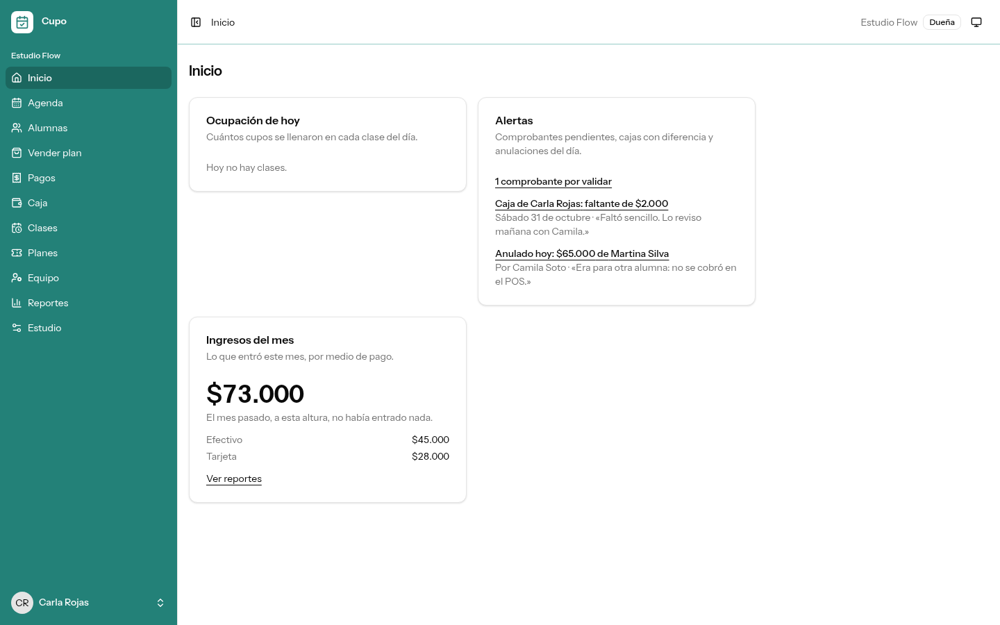
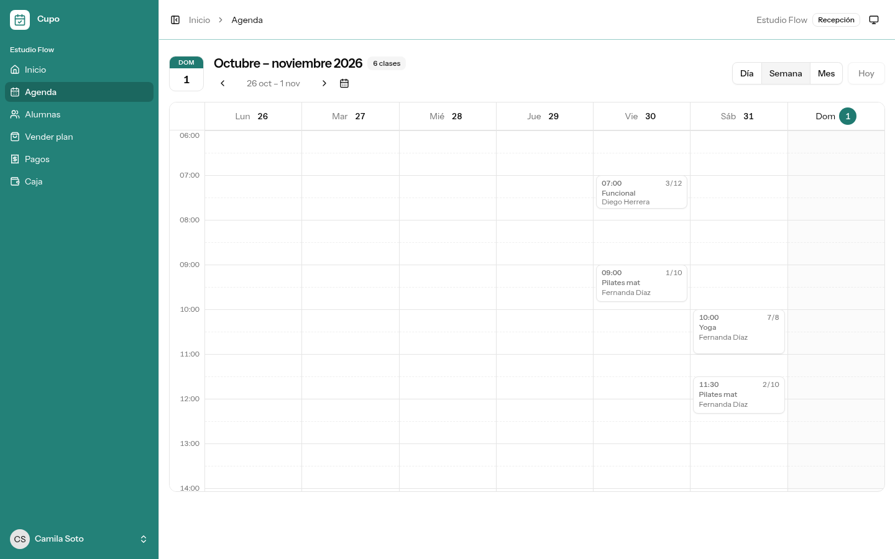
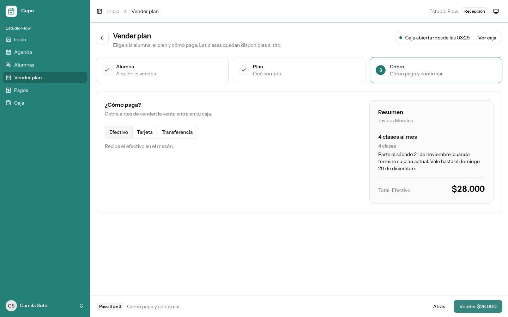
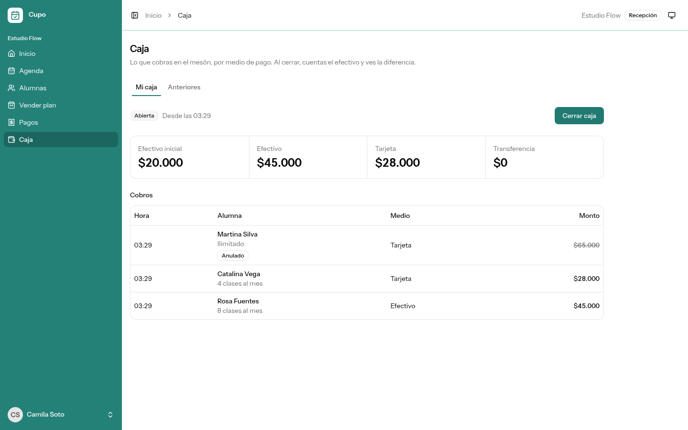
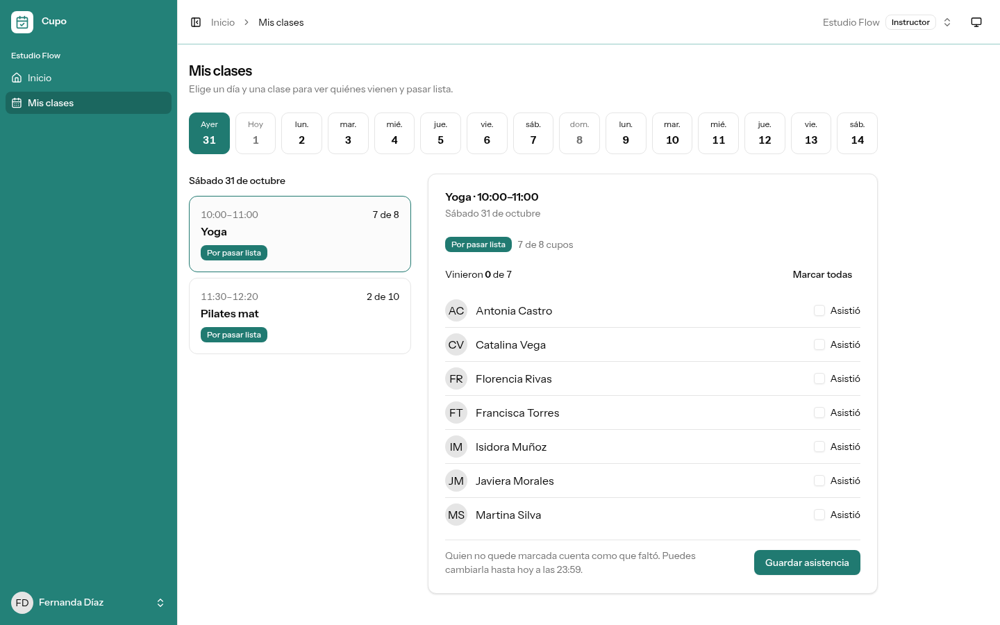
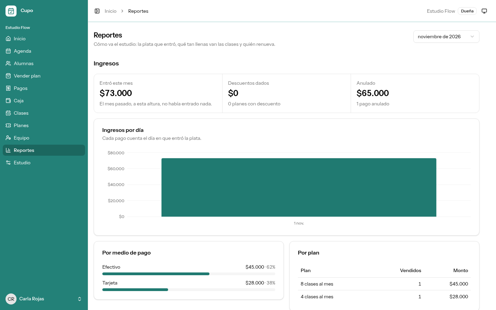
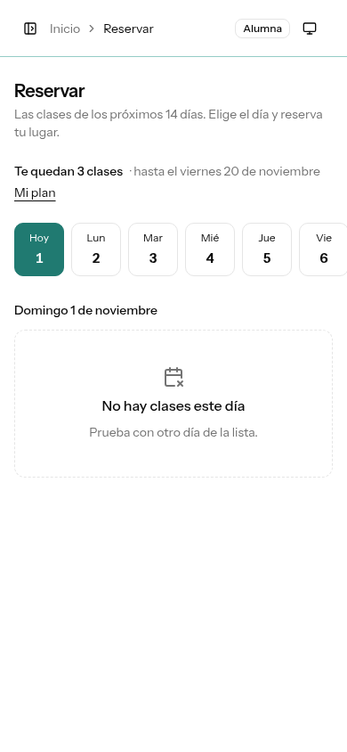

# Cupo

[](https://github.com/eduardoapatat/cupo-app/actions/workflows/tests.yml)
[](LICENSE)

Reservas, planes, pagos y caja para estudios pequeños de clases grupales: pilates, yoga, funcional y baile.

> **Proyecto de portafolio, cerrado.** Cupo es un producto ficticio: el estudio, las personas y los datos de la demo son inventados. Se hicieron las fases 0 a 3. Lo que quedó fuera está en [ideas futuras](docs/roadmap.md#ideas-futuras-fuera-del-alcance).



## El problema

Un estudio pequeño de clases grupales para adultos vende planes («4 u 8 clases al mes», «ilimitado») y maneja todo por WhatsApp, cuaderno y Excel. Pasa esto:

- se reservan más personas que cupos, o quedan cupos vacíos por cancelaciones de última hora;
- nadie sabe con certeza cuántas clases le quedan a cada alumna;
- las transferencias se revisan a mano;
- los planes vencen sin aviso.

### Qué dice la evidencia

- El 49,1 % de las microempresas chilenas no sumó tecnología nueva en 6 meses (Barómetro CNC, julio de 2026). Muchas reciben pedidos por WhatsApp, cobran por transferencia y siguen con planillas ([fuente](https://ecosistemastartup.com/?p=120496)).
- El 89 % de los comercios que reciben transferencias las gestiona a mano (economista jefe de Itaú, encuesta de la CNC y ChilePay, septiembre de 2026; [misma fuente](https://ecosistemastartup.com/?p=120496)).
- En una encuesta de Xepelin a 125 pymes (2024), los principales problemas fueron la falta de liquidez (58,4 %), la cobranza tardía (34,4 %) y los procesos manuales (28 %) ([Emol](https://www.emol.com/noticias/Economia/2025/04/30/1164979/sondeo-startup-xepelin.html)).
- **Sobre los estudios en particular, la evidencia es débil y comercial** (por ejemplo, [SchedulingKit](https://schedulingkit.com/es/whatsapp-booking/pilates-studios)). El problema se sostiene en los datos generales de pymes, no en un estudio del rubro.

## Quién la usa

Cada estudio usa Cupo por su cuenta: no hay catálogo público entre estudios ni super admin. El rol vive en la membresía (persona × estudio):

| Rol        | Qué hace                                                                                                       |
| ---------- | -------------------------------------------------------------------------------------------------------------- |
| Dueña      | Crea su estudio y decide planes, precios, horario, reglas y equipo. Ve los reportes y los ingresos             |
| Recepción  | Inscribe alumnas, vende planes, valida comprobantes, reserva por ellas, y abre y cuadra su caja                |
| Instructor | Ve sus clases con quiénes vienen y pasa lista. No maneja plata                                                 |
| Alumna     | Reserva, cancela, se anota en lista de espera, compra su plan (transferencia o Webpay) y ve sus clases y pagos |

El detalle, con el menú y la matriz de permisos, está en [`docs/roles-y-permisos.md`](docs/roles-y-permisos.md).

## Qué hace

|                                                                                                                                                                |                                                                                                                               |
| -------------------------------------------------------------------------------------------------------------------------------------------------------------- | ----------------------------------------------------------------------------------------------------------------------------- |
|                                                                                             |                                       |
| **Agenda:** recepción y la dueña ven las clases por día, semana o mes; reservan por una alumna, anotan en la lista de espera y cancelan una clase              | **Vender plan:** en tres pasos (alumna, plan y cobro), dentro de la caja abierta de quien vende                               |
|                                                         |                                       |
| **Caja:** se abre con el efectivo inicial y se cierra contando (total o billete por billete). La diferencia queda con su nota, y una caja cerrada ya no cambia | **Mis clases:** el instructor elige un día y una clase, y pasa lista con «Guardar»                                            |
|                                                        |                                                               |
| **Reportes:** ingresos por día, medio y plan; ocupación por horario; asistencia; y los planes que vencen esta semana, para llamar a renovar                    | **Reservar**, desde el celular: la alumna ve cuántas clases le quedan y se anota en la lista de espera si la clase está llena |

## Lo destacado

Las reglas que no se pueden romper las garantiza **PostgreSQL**, no solo PHP. Cada garantía tiene un test con **procesos reales** que corren a la vez (`tests/Concurrency/`):

- **Nunca se sobrevende un cupo.** El cupo se toma con un contador y un `UPDATE` condicional, en la misma transacción que la reserva. Hay un test con 15 personas para 10 cupos ([ADR 0005](docs/decisions/0005-cupo-garantizado-con-contador.md)).
- **La lista de espera es justa.** El cupo que se libera pasa a la primera de la fila en la misma transacción que la cancelación ([ADR 0007](docs/decisions/0007-lista-de-espera-en-la-misma-transaccion.md)).
- **Las clases de un plan no se gastan dos veces.** La fila del plan se bloquea, y el descuento respeta el saldo y el máximo diario ([ADR 0008](docs/decisions/0008-clases-del-plan-con-update-condicional.md)).
- **Una caja cerrada no recibe pagos.** Un trigger con `FOR SHARE` hace que una venta entre en los totales o se rechace, sin quedar suelta ([ADR 0009](docs/decisions/0009-la-caja-cerrada-no-recibe-pagos.md)).
- **Webpay se confirma una sola vez.** El pago se bloquea durante el _commit_. La vuelta por `POST` no pisa la sesión, y cada 5 minutos se revisan los pagos de quien no volvió. Anular un pago devuelve la plata a la tarjeta ([ADR 0010](docs/decisions/0010-webpay-confirmacion-idempotente.md)).
- **Un plan a la vez.** El que se compra antes de tiempo queda en espera, y dos ventas simultáneas se ordenan con un bloqueo por alumna ([ADR 0011](docs/decisions/0011-un-plan-a-la-vez.md)).

Además:

- **Permisos por acción, no por rol.** Hay un Gate por permiso, una Policy por recurso y un test de la matriz completa. Lo de otro estudio responde 404 ([ADR 0003](docs/decisions/0003-rol-en-la-membresia-y-permisos-por-accion.md)).
- **Fechas y plata:** las fechas se guardan en UTC y se muestran en hora de Santiago, y la plata se maneja en pesos enteros.
- **Datos mínimos:** no se pide RUT, fecha de nacimiento ni datos de salud.

**Calidad:** 622 tests de Pest contra PostgreSQL, PHPStan nivel 7, Pint, oxlint/oxfmt y `tsc`. Todo corre en el CI de GitHub Actions.

## Stack

Laravel 13 (PHP 8.5), Fortify, Inertia 3, React 19, TypeScript, Tailwind 4, shadcn/ui, recharts, Wayfinder y PostgreSQL 18. Webpay Plus en el ambiente de integración de Transbank, con el cliente HTTP de Laravel, sin SDK.

## Cómo correrlo en local

Requisitos: PHP 8.5 con Composer, Node 24 con pnpm y Docker.

```sh
composer install
cp .env.example .env
docker compose up -d pgsql mailpit
php artisan key:generate
pnpm install
pnpm run build
php artisan migrate --seed
composer dev
```

- **La app** queda en http://localhost:8000. Los correos (verificación, invitaciones y activación) llegan a Mailpit, en http://localhost:8025.
- **La demo** es Estudio Flow, con una cuenta por rol. Todas usan la contraseña `password`:
    - `carla@example.com`: la dueña;
    - `camila@example.com`: recepción;
    - `fernanda@example.com` y `diego@example.com`: instructores;
    - `javiera@example.com`: alumna.

    Además están Rosa Fuentes, una alumna sin app; Josefa Reyes, con un plan pagado en espera; y Estudio Sur (`paula@example.com`, dueña), donde Fernanda también da clases.

- **Webpay** usa las credenciales públicas de integración de Transbank (necesita internet). La tarjeta de prueba es `4051 8856 0044 6623`, con CVV `123`; en el banco simulado, el RUT es `11.111.111-1` y la clave `123`.
- **`php artisan migrate:fresh --seed`** vuelve a dejar la demo limpia y con las fechas de hoy.
- **`composer ci:check`** corre lo mismo que el CI: lint y formato, tipos, Pint, PHPStan y los tests contra PostgreSQL.

## Documentación

- [`docs/roadmap.md`](docs/roadmap.md): las fases, el cierre y las ideas futuras.
- [`docs/architecture.md`](docs/architecture.md): el mapa del código, los invariantes y los datos personales.
- [`docs/roles-y-permisos.md`](docs/roles-y-permisos.md): los roles, el menú y la matriz de permisos.
- [`docs/decisions/`](docs/decisions/): las decisiones de arquitectura (ADRs).
- [`PRODUCT.md`](PRODUCT.md) y [`DESIGN.md`](DESIGN.md): la ficha de producto y el sistema visual.

## Licencia

[MIT](LICENSE).
