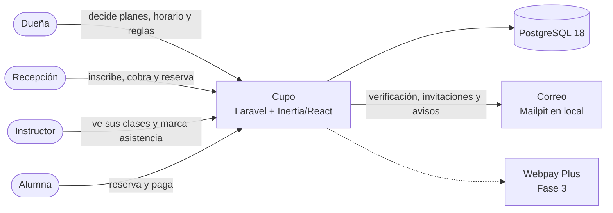

# Arquitectura

Este documento es un mapa de Cupo para quien llega por primera vez al código, sea una persona o una IA. Describe lo que **existe hoy**. Lo que aún no está construido aparece marcado con su fase (ver `docs/roadmap.md`). Se actualiza en el mismo commit que cambia el código.

## Vista general

Cupo es una app ficticia para estudios pequeños de clases grupales para adultos (pilates, yoga, funcional, baile). Cada estudio la usa por su cuenta: la dueña lo administra, recepción atiende el mesón, los instructores ven sus clases y las alumnas reservan y pagan. Es **una sola app con login**: no hay sitio público, catálogo entre estudios ni super admin de la plataforma.

Los roles y lo que puede hacer cada uno están en `docs/roles-y-permisos.md`.

## Stack

| Capa                | Tecnología                                                                              |
| ------------------- | --------------------------------------------------------------------------------------- |
| Backend             | Laravel 13 (PHP 8.5) y Fortify para la autenticación (incluye 2FA y passkeys)           |
| Frontend            | Inertia 3, React 19, TypeScript, Tailwind 4, shadcn/ui y Wayfinder (rutas tipadas)      |
| Base de datos       | PostgreSQL 18. En local corre en Docker (`compose.yaml`, a partir de los stubs de Sail) |
| Correo local        | Mailpit (http://localhost:8025)                                                         |
| Base de datos local | Adminer (http://localhost:8080), opcional: `docker compose up -d adminer`               |
| Calidad             | Pest, Pint, PHPStan/Larastan nivel 7, oxlint/oxfmt (`vp check`) y `tsc`                 |
| Herramientas        | pnpm, Node 24 (`.node-version`), Laravel Boost (MCP y guías para IAs)                   |

## Mapa del código

| Ruta                                   | Qué contiene                                                                                                         |
| -------------------------------------- | -------------------------------------------------------------------------------------------------------------------- |
| `app/Actions/Fortify/`                 | Creación de usuarios y restablecimiento de contraseña, invocados por Fortify                                         |
| `app/Concerns/`                        | Reglas de validación compartidas para el perfil y la contraseña                                                      |
| `app/Http/Controllers/Settings/`       | Perfil y seguridad del usuario (las pantallas de Configuración)                                                      |
| `app/Http/Requests/Settings/`          | Validación de los formularios de Configuración                                                                       |
| `app/Http/Middleware/`                 | `HandleInertiaRequests` (props compartidas) y `HandleAppearance` (tema claro u oscuro)                               |
| `app/Models/`                          | `User`, con verificación de correo, 2FA y passkeys                                                                   |
| `app/Providers/`                       | `AppServiceProvider` (fechas, contraseñas, verbos en español y páginas de error) y `FortifyServiceProvider` (vistas) |
| `config/studio.php`                    | La zona horaria y las reglas por defecto de cada estudio nuevo                                                       |
| `database/`                            | Migraciones del starter (usuarios, caché, colas, passkeys y 2FA), la factory de usuarios y el seeder                 |
| `lang/es/`, `lang/es.json`             | Traducciones del backend: validación, autenticación y correos                                                        |
| `resources/js/pages/`                  | Una página Inertia por pantalla: `auth/`, `settings/`, `dashboard.tsx`, `error.tsx` y `welcome.tsx`                  |
| `resources/js/layouts/`, `components/` | Layouts y componentes. `components/ui/` son los de shadcn, sin modificar                                             |
| `resources/js/actions/`, `routes/`     | Funciones de Wayfinder **generadas** (están en `.gitignore`); no se editan a mano                                    |
| `routes/web.php`, `settings.php`       | Rutas web y de Configuración. Las de autenticación las registra Fortify                                              |
| `tests/Feature/`                       | Tests contra PostgreSQL: autenticación, configuración y páginas de error (`Providers/`)                              |
| `docs/`                                | Esta documentación, la hoja de ruta, los roles y permisos, y las decisiones (`docs/decisions/`)                      |

Lo que viene, según el plan (cada fase lo agrega a esta tabla):

- **Punto 0.3:** `app/Enums/StudioRole` y `StudioPermission`, los modelos `Studio` y `Membership`, el menú por rol (`app/Navigation/`) y las rutas del estudio (`routes/studio.php`).
- **Fases 2 y 3:** las acciones de reservas, créditos, pagos y caja (`app/Actions/`), y las Policies de cada recurso.

## Invariantes

Reglas que el código siempre debe cumplir:

- **Tiempo:** todo se guarda en UTC (`timestamptz`). Se muestra e interpreta en `config('studio.timezone')` (`America/Santiago`), usando el desfase de cada fecha.
- **Dinero:** siempre en CLP, como entero. Nunca `float`.
- **Reglas del negocio:** los valores por defecto viven en `config/studio.php`. Una vez creado el estudio, mandan sus propias reglas. Nunca se repiten los números en el código.
- **Roles:** el rol vive en la membresía (persona × estudio), nunca en el usuario. Los permisos se arman por acción, sin `if rol === ...`. Ver `docs/roles-y-permisos.md`.
- **Aislamiento entre estudios:** un recurso de otro estudio responde 404, para no revelar que existe.
- **Idioma:** el código, los comentarios, los nombres de tablas y la API van en inglés. Todo lo que ve el usuario (textos, URLs del producto, correos y validación) va en español. Ver `docs/decisions/0001-interfaz-solo-en-espanol.md`.
- **Secretos:** `.env` no se versiona. `.env.example` solo trae valores de desarrollo.

## Temas transversales

### Idioma

La interfaz es solo en español:

- Los textos de React se escriben en español directamente en los componentes.
- El backend usa `lang/es` y `lang/es.json`, y `APP_LOCALE=es`.
- Las URLs de Fortify (`/login`, `/register`, `/settings/...`) quedan en inglés.
- Las URLs propias del producto van en español (`/inicio`, `/estudios/{slug}/...`). Las rutas resource usan `/crear` y `/editar` gracias a `Route::resourceVerbs()` en `AppServiceProvider`.

### Tests

- Pest corre contra PostgreSQL, en la base `testing` del mismo contenedor (`phpunit.xml`), nunca contra SQLite. Así se prueban de verdad las garantías de la base: `CHECK`, índices únicos parciales y, en la Fase 2, el cupo bajo concurrencia.
- `composer test` corre Pint, PHPStan y Pest.
- `composer ci:check` agrega oxlint/oxfmt y `tsc`. Es lo que corre GitHub Actions.

### Reglas por defecto

`config/studio.php` reúne la zona horaria y las reglas con que parte cada estudio nuevo: cancelación gratis hasta 6 h antes, reservas hasta 60 minutos antes, lista de espera con el mismo corte que la cancelación, 1 clase al día en los planes ilimitados y aviso 3 días antes del vencimiento. Cada valor se puede cambiar con una variable `STUDIO_*` en `.env`. Al crear un estudio, las reglas se copian a él _(Fase 1)_ y la dueña las puede cambiar _(Fase 2)_.

### Páginas de error

Los 403, 404, 500 y 503 de una visita renderizan la página `error`, en español. Una sesión expirada (419) vuelve atrás con un aviso, y un corte de conexión muestra un toast. Las peticiones JSON conservan sus errores JSON. Ver `AppServiceProvider::configureErrorPages()` y `resources/js/hooks/use-network-error-toast.ts`.

## Datos personales

Cupo guarda lo mínimo para operar (minimización de datos desde el día 1):

| Entidad                                        | Datos                                                                                                         | Nota                                                                                                 |
| ---------------------------------------------- | ------------------------------------------------------------------------------------------------------------- | ---------------------------------------------------------------------------------------------------- |
| Persona                                        | Nombre, teléfono y correo (opcional si la inscribe recepción)                                                 | Sin RUT, fecha de nacimiento ni datos de salud. Al unirse declara ser mayor de 18                    |
| Estudio                                        | Nombre, comuna, enlace de inscripción y reglas                                                                | Hora de Santiago y CLP como enteros                                                                  |
| Membresía                                      | Persona, estudio y rol                                                                                        | El rol vive aquí                                                                                     |
| Tipo de clase y horario semanal                | Nombre, duración, cupo, día, hora e instructor                                                                | Del horario se generan las sesiones (scheduler)                                                      |
| Sesión                                         | Fecha y hora (UTC), cupo, instructor y estado                                                                 | La clase concreta, por ejemplo la del martes a las 19:00                                             |
| Reserva                                        | Sesión, alumna, estado (confirmada, cancelada a tiempo, cancelada tarde, asistió, no asistió) y quién la hizo | Una reserva activa por alumna y sesión                                                               |
| Plan, compra de plan y movimientos de créditos | Precio, créditos, vigencia, máximo diario, saldo y vencimiento                                                | Cada reserva descuenta 1 crédito y cancelar a tiempo lo devuelve. Los movimientos quedan registrados |
| Pago                                           | Monto, medio, comprobante, estado, quién lo registró y la caja                                                | Pendiente → por validar → aprobado, rechazado o anulado                                              |
| Caja                                           | Quién, apertura y cierre, totales por medio y efectivo declarado frente al esperado                           | Cerrada no se modifica; después solo la dueña anula                                                  |

**Por qué no se guardan datos de salud ni de menores.** La Ley 21.719 de protección de datos personales tiene su vigencia fijada para el 1 de diciembre de 2026, aunque hay un proyecto para postergarla a 2027. Esa ley exige consentimiento expreso para los datos sensibles, como los de salud, y el de su representante para los de menores de 16 años. Cupo no los necesita para operar, así que no los pide ni los guarda.

## Modelo de datos _(punto 0.3)_

Pendiente: `studios` y `memberships`, con sus garantías en PostgreSQL.

## Reservas _(Fase 2)_

Pendiente: cómo se generan las sesiones, cómo se garantiza el cupo bajo concurrencia y cómo funciona la lista de espera.

## Créditos, pagos y caja _(Fase 3)_

Pendiente: los movimientos de créditos, los estados del pago, la caja y las anulaciones, y Webpay Plus.

## Automatizaciones y API _(Fases 4 y 5)_

Pendiente: los eventos, las colas, el scheduler y la API.
