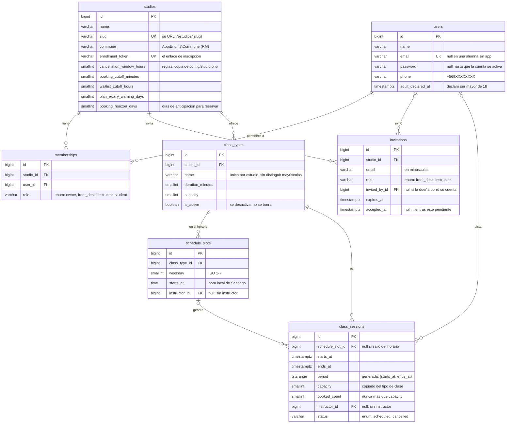

# Arquitectura

Este documento es un mapa de Cupo para quien llega por primera vez al código, sea una persona o una IA. Describe lo que **existe hoy**. Lo que aún no está construido aparece marcado con su fase (ver `docs/roadmap.md`). Se actualiza en el mismo commit que cambia el código.

## Vista general

Cupo es una app ficticia para estudios pequeños de clases grupales para adultos (pilates, yoga, funcional, baile). Cada estudio la usa por su cuenta: la dueña lo administra, recepción atiende el mesón, los instructores ven sus clases y las alumnas reservan y pagan. Es **una sola app con login**: no hay sitio público, catálogo entre estudios ni super admin de la plataforma.

Los roles y lo que puede hacer cada uno están en `docs/roles-y-permisos.md`.

## Stack

| Capa                | Tecnología                                                                              |
| ------------------- | --------------------------------------------------------------------------------------- |
| Backend             | Laravel 13 (PHP 8.5) y Fortify para la autenticación (incluye 2FA y passkeys)           |
| Frontend            | Inertia 3, React 19, TypeScript, Tailwind 4, shadcn/ui y Wayfinder (rutas tipadas)      |
| Base de datos       | PostgreSQL 18. En local corre en Docker (`compose.yaml`, a partir de los stubs de Sail) |
| Correo local        | Mailpit (http://localhost:8025)                                                         |
| Base de datos local | Adminer (http://localhost:8080), opcional: `docker compose up -d adminer`               |
| Calidad             | Pest, Pint, PHPStan/Larastan nivel 7, oxlint/oxfmt (`vp check`) y `tsc`                 |
| Herramientas        | pnpm, Node 24 (`.node-version`), Laravel Boost (MCP y guías para IAs)                   |

## Mapa del código

| Ruta                                           | Qué contiene                                                                                                                                                                                                                                                                                   |
| ---------------------------------------------- | ---------------------------------------------------------------------------------------------------------------------------------------------------------------------------------------------------------------------------------------------------------------------------------------------- |
| `app/Actions/Fortify/`                         | Creación de usuarios y restablecimiento de contraseña, invocados por Fortify                                                                                                                                                                                                                   |
| `app/Actions/Studios/`                         | `CreateStudio` (el estudio con las reglas por defecto y su dueña, en una transacción) y `JoinStudioAsStudent` (lo que hace el enlace de inscripción)                                                                                                                                           |
| `app/Actions/Team/`                            | `InviteToStudio`, `SendInvitation` (también reenvía) y `AcceptInvitation` (con la fila bloqueada, para que un enlace no se use dos veces)                                                                                                                                                      |
| `app/Actions/Students/`                        | `EnrollStudent` (inscribir en el mesón a quien no usa la app) y `SendActivation` (el enlace para que active su cuenta)                                                                                                                                                                         |
| `app/Actions/Classes/`                         | `GenerateSessions` (las sesiones de los próximos días desde el horario) y `ApplyScheduleChange` (regenera las sesiones sin reservas tras un cambio de horario)                                                                                                                                 |
| `app/Console/Commands/`                        | `sessions:generate`, programado cada noche en `routes/console.php`                                                                                                                                                                                                                             |
| `app/Concerns/`                                | Reglas de validación compartidas para el perfil, la contraseña y la declaración de mayoría de edad, y `HasUniqueSlug` (el slug del estudio)                                                                                                                                                    |
| `app/Enums/`                                   | `StudioRole` (los 4 roles, con sus permisos y su menú), `StudioPermission` (una acción por fila de la matriz), `Commune`, `Weekday` y `ClassSessionStatus`                                                                                                                                     |
| `app/Navigation/`                              | `MenuItem`: los ítems del menú, con su etiqueta, el permiso que exigen y su ruta (o «Pronto»)                                                                                                                                                                                                  |
| `app/Notifications/`                           | `StudioInvitation` (la invitación al equipo) y `ActivateAccount` (activar la cuenta de una alumna sin app), en cola y con enlaces firmados                                                                                                                                                     |
| `app/Http/Controllers/`                        | `DashboardController` (`/inicio`), `StudioController` (crear el estudio), los enlaces públicos `InvitationController`, `EnrollmentController` y `AccountActivationController`, `Studio/` (las pantallas de cada estudio: Inicio, Estudio, Equipo y Alumnas) y `Settings/` (perfil y seguridad) |
| `app/Http/Requests/`                           | Validación de los formularios, con mensajes en español: `StudioRequest` (crear y editar el estudio) y `Settings/` (Configuración)                                                                                                                                                              |
| `app/Http/Middleware/`                         | `HandleInertiaRequests` (props compartidas, incluido el estudio con su menú), `RememberCurrentStudio` (el estudio actual) y `HandleAppearance` (tema)                                                                                                                                          |
| `app/Models/`                                  | `User`, `Studio`, `Membership` e `Invitation`, con casts a enums, relaciones y scopes (`pending`)                                                                                                                                                                                              |
| `app/Policies/`                                | `StudioPolicy`, que Laravel descubre sola: solo los miembros entran a un estudio                                                                                                                                                                                                               |
| `app/Providers/`                               | `AppServiceProvider` (fechas, contraseñas, un Gate por permiso, verbos en español y páginas de error) y `FortifyServiceProvider` (vistas)                                                                                                                                                      |
| `config/studio.php`                            | La zona horaria y las reglas por defecto de cada estudio nuevo                                                                                                                                                                                                                                 |
| `database/`                                    | Migraciones (con las garantías de PostgreSQL), factories con estados y el seeder demo (`DemoStudioSeeder`)                                                                                                                                                                                     |
| `lang/es/`, `lang/es.json`                     | Traducciones del backend: validación, autenticación y correos                                                                                                                                                                                                                                  |
| `resources/js/pages/`                          | Una página Inertia por pantalla: `studios/` (Inicio de cada rol, crear el estudio, Estudio, Equipo, Alumnas y el estado sin estudio), las páginas públicas `invitations/`, `enrollment/` y `activation/`, `auth/`, `settings/`, `error.tsx` y `welcome.tsx`                                    |
| `resources/js/layouts/`, `components/`, `lib/` | Layouts y componentes. `studio-nav.tsx` dibuja el menú del estudio y `studio-form.tsx` el formulario del estudio; `lib/form.ts` enlaza cada campo con su error (`aria-invalid`, `aria-describedby`) y lleva el foco al primero; `components/ui/` son los de shadcn, sin modificar              |
| `resources/js/actions/`, `routes/`             | Funciones de Wayfinder **generadas** (están en `.gitignore`); no se editan a mano                                                                                                                                                                                                              |
| `routes/web.php`, `studio.php`, `settings.php` | Rutas web, del estudio y de Configuración. Las de autenticación las registra Fortify                                                                                                                                                                                                           |
| `tests/Feature/`                               | Tests contra PostgreSQL: la matriz de permisos (`Authorization/`), el menú (`Navigation/`), la base (`Models/`), las policies, las pantallas (`Http/`), el seeder, la autenticación y las páginas de error                                                                                     |
| `docs/`                                        | Esta documentación, la hoja de ruta, los roles y permisos, y las decisiones (`docs/decisions/`)                                                                                                                                                                                                |

Lo que viene, según el plan (cada fase lo agrega a esta tabla):

- **Fases 2 y 3:** las acciones de reservas, créditos, pagos y caja, y las Policies de cada recurso.
- **Fases 2 y 3:** las acciones de reservas, créditos, pagos y caja, y las Policies de cada recurso.

## Invariantes

Reglas que el código siempre debe cumplir:

- **Tiempo:** todo se guarda en UTC (`timestamptz`). Se muestra e interpreta en `config('studio.timezone')` (`America/Santiago`), usando el desfase de cada fecha.
- **Dinero:** siempre en CLP, como entero. Nunca `float`.
- **Reglas del negocio:** los valores por defecto viven en `config/studio.php`. Una vez creado el estudio, mandan sus propias reglas. Nunca se repiten los números en el código.
- **Roles:** el rol vive en la membresía (persona × estudio), nunca en el usuario. Los permisos se arman por acción, sin `if rol === ...`. Ver `docs/roles-y-permisos.md`.
- **Aislamiento entre estudios:** un recurso de otro estudio responde 404, para no revelar que existe.
- **Idioma:** el código, los comentarios, los nombres de tablas y la API van en inglés. Todo lo que ve el usuario (textos, URLs del producto, correos y validación) va en español. Ver `docs/decisions/0001-interfaz-solo-en-espanol.md`.
- **Secretos:** `.env` no se versiona. `.env.example` solo trae valores de desarrollo.

## Temas transversales

### Idioma

La interfaz es solo en español:

- Los textos de React se escriben en español directamente en los componentes.
- El backend usa `lang/es` y `lang/es.json`, y `APP_LOCALE=es`.
- Las URLs de Fortify (`/login`, `/register`, `/settings/...`) quedan en inglés.
- Las URLs propias del producto van en español (`/inicio`, `/estudios/{slug}/...`). Las rutas resource usan `/crear` y `/editar` gracias a `Route::resourceVerbs()` en `AppServiceProvider`.

### Tests

- Pest corre contra PostgreSQL, en la base `testing` del mismo contenedor (`phpunit.xml`), nunca contra SQLite. Así se prueban de verdad las garantías de la base: `CHECK`, índices únicos parciales y, en la Fase 2, el cupo bajo concurrencia.
- `composer test` corre Pint, PHPStan y Pest.
- `composer ci:check` agrega oxlint/oxfmt y `tsc`. Es lo que corre GitHub Actions.

### Reglas por defecto

`config/studio.php` reúne la zona horaria y las reglas con que parte cada estudio nuevo: cancelación gratis hasta 6 h antes, reservas hasta 60 minutos antes, lista de espera con el mismo corte que la cancelación, 1 clase al día en los planes ilimitados y aviso 3 días antes del vencimiento. Cada valor se puede cambiar con una variable `STUDIO_*` en `.env`. Al crear un estudio, las reglas se copian a él _(Fase 1)_ y la dueña las puede cambiar _(Fase 2)_.

### Páginas de error

Los 403, 404, 500 y 503 de una visita renderizan la página `error`, en español. Una sesión expirada (419) vuelve atrás con un aviso, y un corte de conexión muestra un toast. Las peticiones JSON conservan sus errores JSON. Ver `AppServiceProvider::configureErrorPages()` y `resources/js/hooks/use-network-error-toast.ts`.

## Datos personales

Cupo guarda lo mínimo para operar (minimización de datos desde el día 1):

| Entidad                                        | Datos                                                                                                         | Nota                                                                                                 |
| ---------------------------------------------- | ------------------------------------------------------------------------------------------------------------- | ---------------------------------------------------------------------------------------------------- |
| Persona                                        | Nombre, teléfono y correo (opcional si la inscribe recepción)                                                 | Sin RUT, fecha de nacimiento ni datos de salud. Al unirse declara ser mayor de 18                    |
| Estudio                                        | Nombre, comuna, enlace de inscripción y reglas                                                                | Hora de Santiago y CLP como enteros                                                                  |
| Membresía                                      | Persona, estudio y rol                                                                                        | El rol vive aquí                                                                                     |
| Tipo de clase y horario semanal                | Nombre, duración, cupo, día, hora e instructor                                                                | Del horario se generan las sesiones (scheduler)                                                      |
| Sesión                                         | Fecha y hora (UTC), cupo, instructor y estado                                                                 | La clase concreta, por ejemplo la del martes a las 19:00                                             |
| Reserva                                        | Sesión, alumna, estado (confirmada, cancelada a tiempo, cancelada tarde, asistió, no asistió) y quién la hizo | Una reserva activa por alumna y sesión                                                               |
| Plan, compra de plan y movimientos de créditos | Precio, créditos, vigencia, máximo diario, saldo y vencimiento                                                | Cada reserva descuenta 1 crédito y cancelar a tiempo lo devuelve. Los movimientos quedan registrados |
| Pago                                           | Monto, medio, comprobante, estado, quién lo registró y la caja                                                | Pendiente → por validar → aprobado, rechazado o anulado                                              |
| Caja                                           | Quién, apertura y cierre, totales por medio y efectivo declarado frente al esperado                           | Cerrada no se modifica; después solo la dueña anula                                                  |

**Por qué no se guardan datos de salud ni de menores.** La Ley 21.719 de protección de datos personales tiene su vigencia fijada para el 1 de diciembre de 2026, aunque hay un proyecto para postergarla a 2027. Esa ley exige consentimiento expreso para los datos sensibles, como los de salud, y el de su representante para los de menores de 16 años. Cupo no los necesita para operar, así que no los pide ni los guarda.

## Modelo de datos

Las garantías viven en PostgreSQL, no solo en PHP:

| Garantía                                                                                                     | Dónde                           | Qué evita                                                                                                        |
| ------------------------------------------------------------------------------------------------------------ | ------------------------------- | ---------------------------------------------------------------------------------------------------------------- |
| `CHECK` del rol (generado por `$table->enum()`)                                                              | `memberships`                   | Un rol desconocido (SQLSTATE `23514`)                                                                            |
| `UNIQUE (studio_id, user_id)`                                                                                | `memberships`                   | Dos roles para la misma persona en el mismo estudio (`23505`)                                                    |
| `UNIQUE (studio_id) WHERE role = 'owner'`, con `DB::statement` porque Blueprint no tiene índices parciales   | `memberships`                   | Una segunda dueña en el estudio (`23505`)                                                                        |
| `UNIQUE (user_id) WHERE role = 'owner'`                                                                      | `memberships`                   | Que una persona sea dueña de dos estudios (`23505`): Cupo no maneja sucursales                                   |
| `CHECK` de reglas no negativas                                                                               | `studios`                       | Una ventana de cancelación, un cierre de reservas o un aviso negativos (`23514`)                                 |
| `UNIQUE (studio_id, email) WHERE accepted_at IS NULL` y `CHECK (email = lower(email))`                       | `invitations`                   | Dos invitaciones pendientes al mismo correo, aunque cambien las mayúsculas (`23505`)                             |
| `CHECK` del rol (`front_desk` o `instructor`)                                                                | `invitations`                   | Invitar a alguien como dueña o como alumna (`23514`)                                                             |
| `CHECK (booked_count >= 0 AND booked_count <= capacity)`                                                     | `class_sessions`                | Vender más cupos que los de la clase, venga de donde venga la escritura (`23514`). Ver el ADR 0005 _(punto 2.2)_ |
| `EXCLUDE USING gist (studio_id WITH =, period WITH &&)` solo para las sesiones `scheduled`, con `btree_gist` | `class_sessions`                | Dos clases que se pisan en la única sala del estudio (`23P01`)                                                   |
| `UNIQUE (schedule_slot_id, starts_at)`                                                                       | `class_sessions`                | Generar dos veces la misma clase                                                                                 |
| `CHECK` de cupo y duración positivos, y día entre 1 y 7                                                      | `class_types`, `schedule_slots` | Clases imposibles (`23514`)                                                                                      |
| Claves foráneas con `ON DELETE CASCADE`                                                                      | `memberships`                   | Membresías de un estudio o de una persona que ya no existen                                                      |

## Permisos y navegación

### Cómo se autoriza

Todo usa mecanismos nativos de Laravel, sin middleware propio de roles ni super admin. Ver `docs/decisions/0003-rol-en-la-membresia-y-permisos-por-accion.md`.

- **Entrar a un estudio:** `StudioPolicy::view`, aplicada al grupo de rutas con `->can('view', 'studio')`. A quien no es miembro le responde **404** (`Response::denyAsNotFound()`), igual que a un estudio que no existe.
- **Cada acción:** un Gate por caso de `StudioPermission`, definido en `AppServiceProvider::configureAuthorization()`, que mira el rol de la persona en ese estudio: `Gate::allows('payments.review', $studio)`. Las pantallas de las próximas fases los aplican en sus rutas o con `#[Authorize]`.
- **Solo las suyas:** el instructor con sus sesiones y la alumna con sus reservas los filtra la Policy de cada recurso _(Fases 2 y 3)_.

### Rutas

| URL                                 | Qué es                                                                                                                                                                            |
| ----------------------------------- | --------------------------------------------------------------------------------------------------------------------------------------------------------------------------------- |
| `/inicio`                           | El `home` de Fortify. Lleva al Inicio del estudio actual o, a quien no pertenece a ninguno, muestra «Todavía no perteneces a un estudio»                                          |
| `/estudios/{slug}`                  | El Inicio del estudio, con los bloques del rol de la persona                                                                                                                      |
| `/estudios/crear`                   | Crear mi estudio (nombre y comuna). Responde 403 a quien ya es dueña de uno                                                                                                       |
| `/estudios/{slug}/estudio`          | «Estudio»: la dueña edita el nombre y la comuna. El slug no cambia, para no romper los enlaces                                                                                    |
| `/estudios/{slug}/equipo`           | «Equipo»: el equipo, invitar, las invitaciones pendientes (reenviar y cancelar) y quitar a alguien. Una invitación o una membresía de otro estudio responde 404 (scoped bindings) |
| `/invitaciones/{id}` (GET y POST)   | Pública y firmada: ver la invitación y aceptarla. Ver «Invitaciones» abajo                                                                                                        |
| `/estudios/{slug}/alumnas`          | «Alumnas»: el enlace para compartir, inscribir en el mesón, la lista con su estado, editar a quien no usa la app y reenviarle la activación                                       |
| `/inscripcion/{token}` (GET y POST) | Pública: el enlace de inscripción del estudio. Un token renovado responde 404                                                                                                     |
| `/activar-cuenta/{id}` (GET y POST) | Pública y firmada: una alumna sin app crea su contraseña                                                                                                                          |
| `/estudios/{slug}/clases`           | «Clases»: el horario semanal como tablero por día (cada clase se edita en un panel lateral) y los tipos de clase. Dos clases del mismo día no se pueden cruzar                    |

### El estudio actual y el menú

- **Siempre hay un estudio actual:** el de la página o, fuera de un estudio (por ejemplo en Configuración), el último que la persona abrió. Lo guarda en la sesión el middleware `RememberCurrentStudio`. Si ya no pertenece a ese estudio, se usa el primero por nombre.
- **Props:** `HandleInertiaRequests` comparte `studio` (nombre, slug, rol y menú) y `studios` (todos los de la persona, con su rol, para el selector). Nunca comparte un estudio al que la persona no pertenece, ni siquiera en el 404 de uno ajeno, y las membresías no viajan dentro de `auth.user`.
- **El menú lo arma el servidor:** `StudioRole::menu()` da los ítems y su orden, y `MenuItem` su etiqueta y su ruta. El frontend (`studio-nav.tsx`) solo elige el ícono de cada ítem. Los ítems sin ruta se ven atenuados con «Pronto».
- **El rol se ve arriba a la derecha:** la barra de los breadcrumbs (`app-sidebar-header.tsx`) muestra el estudio actual y el rol de la persona en una insignia, en todas las páginas. En el celular queda solo la insignia.
- **El selector de estudio** es eso mismo cuando la persona pertenece a más de uno: un menú con sus estudios y su rol en cada uno. Cada opción es un enlace al Inicio de ese estudio, así que no hace falta otro endpoint: `RememberCurrentStudio` lo recuerda. «Crear mi estudio» no aparece ahí; solo se ofrece a quien no pertenece a ningún estudio.

### Invitaciones

1. **La dueña invita** desde «Equipo» con un correo y un rol (recepción o instructor). No se invita a quien ya es del estudio ni dos veces al mismo correo: una pendiente se reenvía desde la lista.
2. **El correo sale en cola** (`StudioInvitation`, `ShouldQueue`, después del commit) con un enlace `URL::temporarySignedRoute` que vence a los `config('studio.invitation_days')` días (7). Reenviar renueva el plazo y manda un enlace nuevo.
3. **El enlace es público**, porque quien lo abre puede no tener cuenta. Primero se revisa la firma: un enlace alterado responde 404, igual que una invitación inexistente, para no revelar cuáles existen. Una invitación usada o vencida responde 410 con una explicación.
4. **Según quién lo abre:**
    - sin cuenta, crea la suya (nombre, contraseña y la declaración de 18) con el correo invitado, que queda verificado porque el enlace llegó ahí;
    - con cuenta, inicia sesión y Fortify lo trae de vuelta (`url.intended`);
    - con otra sesión abierta, se le pide entrar con el correo invitado;
    - si ya es parte del estudio, se le avisa y su rol no cambia.
5. **Aceptar** (`AcceptInvitation`) bloquea la fila de la invitación, crea la membresía y la marca aceptada en una transacción.

### Quitar a alguien del equipo

Quitar a alguien borra su membresía, así que en ese estudio queda **sin rol**: pierde el acceso al tiro (404) y no pasa a ser alumna. Su cuenta y sus roles en otros estudios no cambian. Si quiere tomar clases ahí, entra por el enlace de inscripción, y si vuelve al equipo, se le invita de nuevo. Solo se quita a recepción e instructores, nunca a la dueña.

### Enlace de inscripción

- Cada estudio tiene un token (`studios.enrollment_token`) y su enlace `/inscripcion/{token}`, que la dueña copia y renueva desde «Estudio» y recepción copia desde «Alumnas». Renovarlo deja sin efecto el anterior.
- Quien entra sin cuenta la crea con las mismas reglas del registro (`CreateNewUser`, con la declaración de 18 y el correo de verificación). Quien ya tiene sesión se une con un botón. En los dos casos queda como **alumna al tiro**: sin un plan pagado igual no puede reservar _(Fase 3)_.
- Quien ya es parte del estudio conserva su rol.

### Alumnas sin app

Ver `docs/decisions/0004-alumnas-sin-app.md`.

- Recepción inscribe en el mesón con nombre y celular (normalizado a `+569XXXXXXXX`), correo opcional y la declaración de 18. La persona queda sin contraseña (`User::usesApp()` es falso) y no puede iniciar sesión.
- Si tiene correo, `ActivateAccount` le manda un enlace firmado que vence a los `config('studio.activation_days')` días (7) y lleva el hash del correo: si recepción lo corrige, los enlaces anteriores dejan de servir. Al crear su contraseña, su correo queda verificado e inicia sesión.
- Mientras no use la app, recepción corrige sus datos y reenvía la activación. Después, sus datos son suyos y nadie del estudio los edita.
- No se inscribe en el mesón un correo que ya tiene cuenta: se le comparte el enlace del estudio.

### Buscar alumnas

- «Alumnas» filtra por estado (`StudentStatus`: con app, activación enviada y sin app) con `?estado=con-app`, y busca con `?buscar=` en el nombre o el correo, sin distinguir mayúsculas ni tildes (la extensión `unaccent` de PostgreSQL), y en el celular por sus dígitos. Los comodines de `LIKE` se buscan tal cual.
- Las cantidades de cada pestaña respetan la búsqueda y salen en una sola consulta (`count(*) filter (where …)`).
- Inscribir, editar y reenviar la activación vuelven a la misma lista, con su búsqueda y su pestaña.

### Usuarios demo

`php artisan migrate --seed` crea dos estudios. Todas las cuentas usan la contraseña `password`:

| Persona         | Correo                 | Rol                                              |
| --------------- | ---------------------- | ------------------------------------------------ |
| Carla Rojas     | `carla@example.com`    | Dueña de Estudio Flow (`/estudios/estudio-flow`) |
| Camila Soto     | `camila@example.com`   | Recepción en Estudio Flow                        |
| Fernanda Díaz   | `fernanda@example.com` | Instructora en Estudio Flow y en Estudio Sur     |
| Diego Herrera   | `diego@example.com`    | Instructor en Estudio Flow                       |
| Javiera Morales | `javiera@example.com`  | Alumna de Estudio Flow                           |
| Rosa Fuentes    | (sin correo)           | Alumna de Estudio Flow sin app: no puede entrar  |
| Paula Vidal     | `paula@example.com`    | Dueña de Estudio Sur                             |

## Horario y sesiones

Ver `docs/decisions/0006-sesiones-generadas-desde-el-horario.md`.

- **El horario semanal** (`schedule_slots`) guarda el día y la hora local. **Las sesiones** (`class_sessions`) son las clases concretas que se reservan, en UTC.
- **`GenerateSessions`** crea las sesiones de los próximos `booking_horizon_days` días (14 por defecto), con el desfase de cada fecha en Santiago. Corre cada noche (`sessions:generate`, a las 00:10) y también al cambiar el horario o las reglas. Es idempotente (`ON CONFLICT DO NOTHING`).
- **Cambiar el horario** regenera solo las sesiones futuras sin reservas; las que ya tienen reservas quedan como estaban. Quitar una clase del horario mantiene sus sesiones con reservas.
- **Una clase que ya no se da** se desactiva: deja de generar sesiones y sus sesiones vacías desaparecen.
- **Quitar a un instructor** del equipo deja sin instructor sus horarios y sus sesiones futuras, en la misma transacción. Las alumnas no pueden reservar una sesión sin instructor _(punto 2.2)_.
- **Las reglas** del estudio (ventana de cancelación, cierre de reservas, corte de la lista de espera y anticipación) se editan en «Estudio» → «Reglas» (`rules.manage`). Una anticipación mayor genera al tiro las sesiones de los días nuevos.

## Reservas _(puntos 2.2 y 2.3)_

Pendiente: cómo se garantiza el cupo bajo concurrencia, cómo funcionan la lista de espera y la asistencia.

## Créditos, pagos y caja _(Fase 3)_

Pendiente: los movimientos de créditos, los estados del pago, la caja y las anulaciones, y Webpay Plus.

## Automatizaciones y API _(Fases 4 y 5)_

Pendiente: los eventos, las colas, el scheduler y la API.
